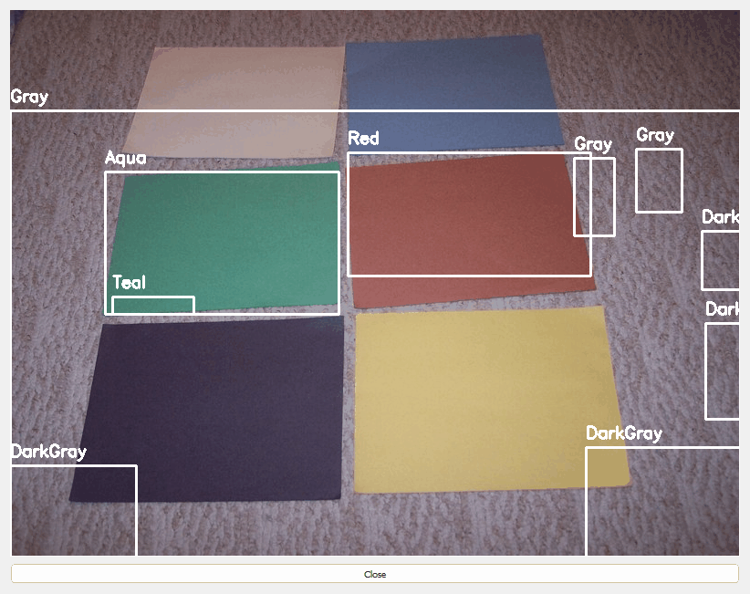
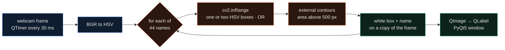
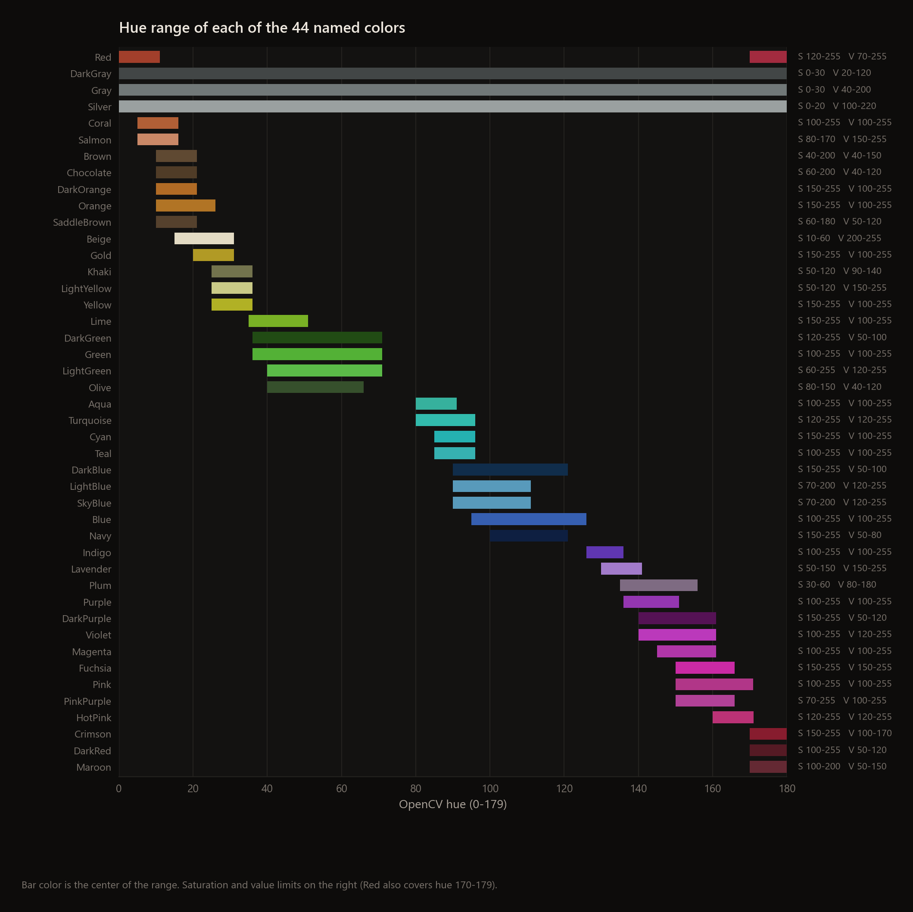
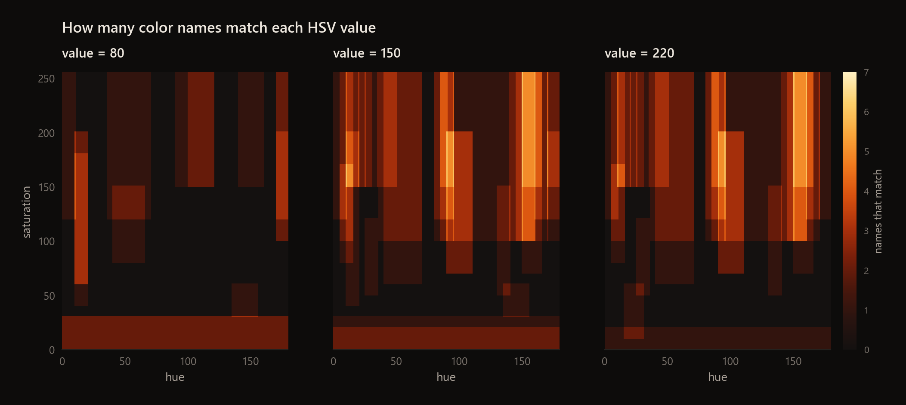
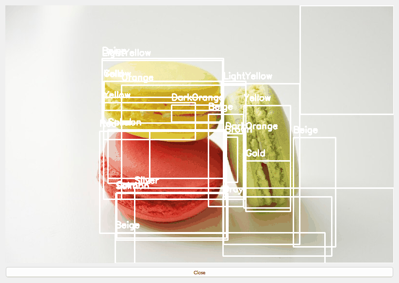
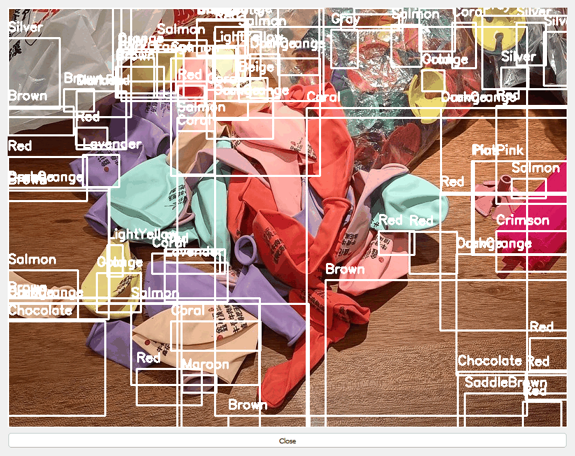

<div align="center">

# Color Detection

**A PyQt5 webcam app that boxes and names regions of 44 colors, using fixed HSV ranges and contours in OpenCV.**




</div>

The app reads the webcam every 30 ms, converts each frame to HSV, and for every named color draws a white box and
the name around each blob that falls inside that color's HSV range. There is no model and no training: the 44 names
and their ranges are written out by hand in `color_detection_app.py`. The screenshot above is the real window, fed a
photo instead of the webcam, and it shows both what works and where the hand-written ranges leave gaps.

## Highlights

- 44 named colors, from Red and Navy to Khaki, Plum and Lavender, each defined by one or two HSV boxes (Red wraps around hue 0 and uses two).
- Detection is `cv2.inRange` per color, external contours and a 500-pixel area threshold, all on the CPU. On 800×600 photos one `update_frame()` took 36 to 138 ms on my machine, depending on how many boxes it draws.
- The ranges overlap heavily: 62% of saturated, bright HSV values (S and V at least 100) match two or more names, and one value can match up to 7.
- They also leave gaps: 44% of all 11.8 million HSV values match no name, including pure black and pure white, and in the photo above four of the six paper sheets get no label.

---

## How it works



Every name is checked independently, so a region that fits several ranges gets several boxes on top of each other.
Boxes are drawn on a copy of the frame and the result is converted to a `QImage` for the window. The Close button
stops the timer and releases the camera.



## Results

I ran the app on still photos by swapping `cv2.VideoCapture` for a class that returns the photo
(`scripts/screenshot.py`), so every screenshot here is the actual window. The construction-paper photo is a good
test because each sheet is one flat color. I measured each sheet's median HSV and checked which names contain it
(`scripts/sheet_hsv.py`):

| sheet | median H, S, V | names that contain the median | what the app draws |
|---|---|---|---|
| green | 82, 108, 136 | Aqua | Aqua over the sheet, Teal on part of it |
| brick red | 2, 118, 148 | none (Red needs S ≥ 120) | Red, from the part of the sheet above S 120 |
| yellow | 22, 100, 200 | none | nothing |
| blue | 114, 78, 121 | none | nothing |
| dark purple | 133, 77, 75 | none | nothing |
| cream | 4, 34, 167 | none | nothing |
| carpet | 156, 28, 108 | Gray, DarkGray | 7 boxes |

The yellow sheet is the clearest miss. Its hue of 22 is below LightYellow and Yellow (25 and up), and its
saturation of 100 is too high for Beige and too low for Gold and Orange (150 and up). The blue and purple sheets
are muted (S below 100), and most names start at S 100. The low-saturation names in those hues don't reach them:
LightBlue and SkyBlue stop at hue 110, Lavender needs V ≥ 150 and Plum stops at S 60.



Counting over the whole 8-bit HSV cube (180 × 256 × 256 values), 44.4% match no name, 22.8% match exactly one and
32.8% match two or more. The busiest value, hue 10, saturation 150, value 100, matches Red, Coral, Brown,
SaddleBrown, Chocolate, Orange and DarkOrange at once.

In busier scenes the overlap shows up as stacks of boxes. The macaron photo produced 23 boxes from 12 names, and the
balloon photo 86 boxes from 19 names:

 

A screen recording of the live webcam version is on [YouTube](https://www.youtube.com/watch?v=BXeNC1eGSfs).

## Quickstart

```bash
git clone https://github.com/EllE961/Color-Detection
cd Color-Detection
pip install -r requirements.txt
python color_detection_app.py                      # needs a webcam at index 0
```

Without a webcam, or to reproduce the images and numbers above:

```bash
python scripts/screenshot.py docs/assets/paper.jpg docs/assets/app_paper.png   # prints box counts per name
python scripts/sheet_hsv.py                                                    # the table above
python scripts/make_figures.py                                                 # range and coverage figures
```

## Repository map

```text
color_detection_app.py   the app: HSV ranges, detection loop, PyQt5 window
requirements.txt
scripts/
  screenshot.py          runs the app on a still image and saves the window
  sheet_hsv.py           median HSV of each paper sheet and the names that contain it
  make_figures.py        color_ranges.png, hsv_coverage.png, results/coverage.json
results/                 coverage stats, per-sheet medians, box counts per screenshot
docs/assets/             test photos, screenshots, figures
```

## Limitations

- The ranges are hand-written and fixed. They are not calibrated to any camera or lighting, and a shadow or white-balance shift moves a surface from one name to another, or to none.
- Overlapping ranges give stacked boxes with different names on the same object. Five names (Khaki, Salmon, Coral, Chocolate, Maroon) are also defined twice in the dict; the duplicates are identical, so only 44 of the 49 entries count.
- There is no Black or White, and most low-saturation colors only match Gray, DarkGray or Silver.
- Labels are white text with no background, which is hard to read on light objects (see the macaron screenshot).
- The 500-pixel area threshold is in absolute pixels, so how small an object can be depends on the camera resolution.
- The timer fires every 30 ms, but on busy scenes a frame takes longer than that (138 ms for the balloon photo here), so the frame rate drops as boxes pile up.

## License

MIT, see [LICENSE](LICENSE). Test photos from Wikimedia Commons: [Construction Paper](https://commons.wikimedia.org/wiki/File:Construction_Paper.JPG)
by Dancer204 (public domain), [Colorful Macarons](https://commons.wikimedia.org/wiki/File:Colorful_Macarons_(Unsplash).jpg)
by Tatiana Lapina (CC0) and [Uninflated colorful balloons](https://commons.wikimedia.org/wiki/File:Uninflated_colorful_balloons.jpg)
by Fumikas Sagisavas (CC0).
